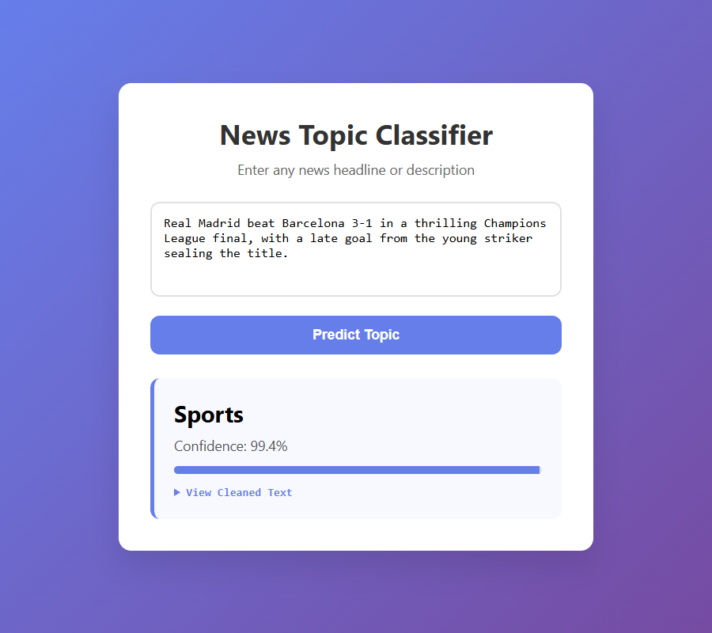
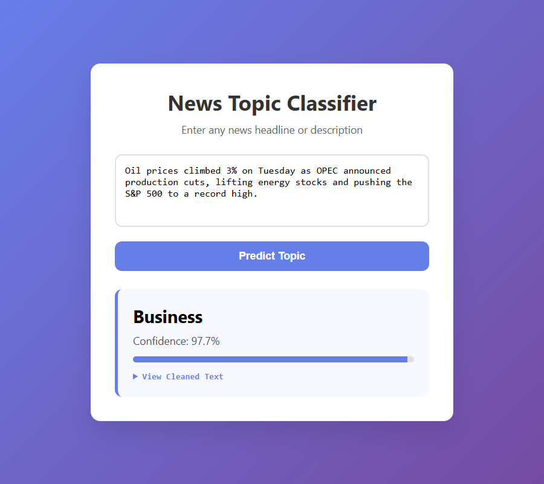
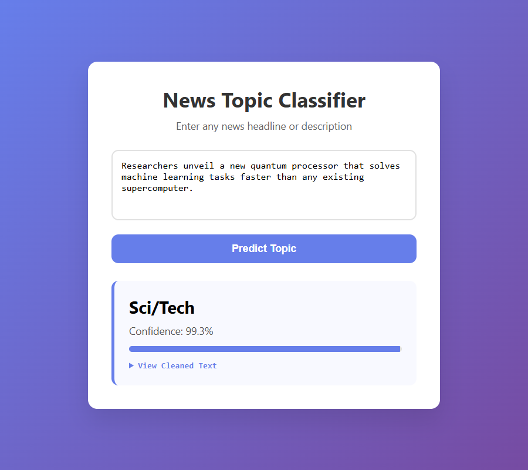
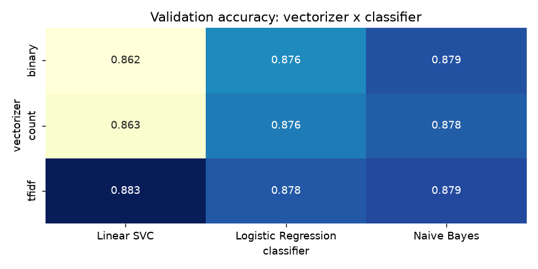
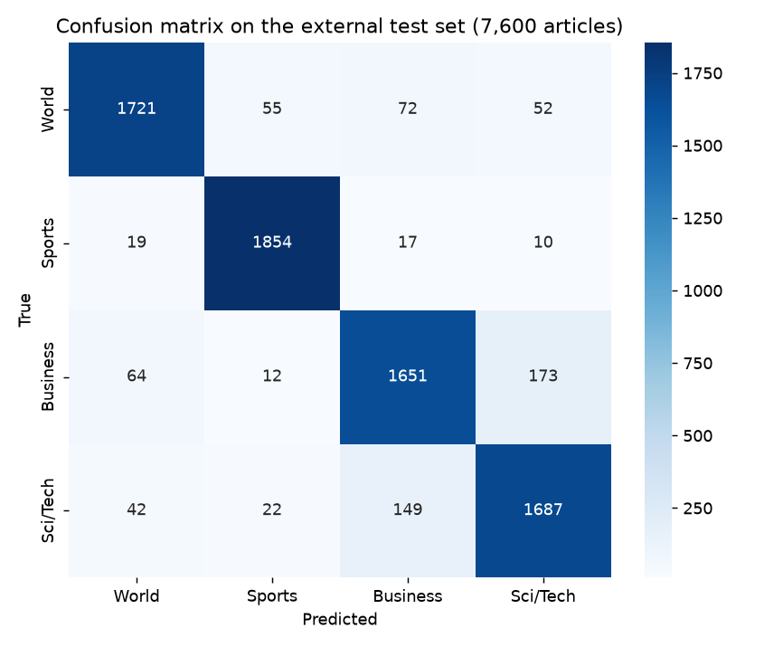
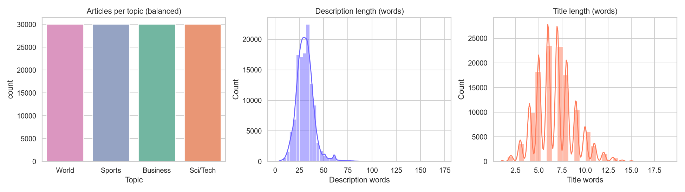
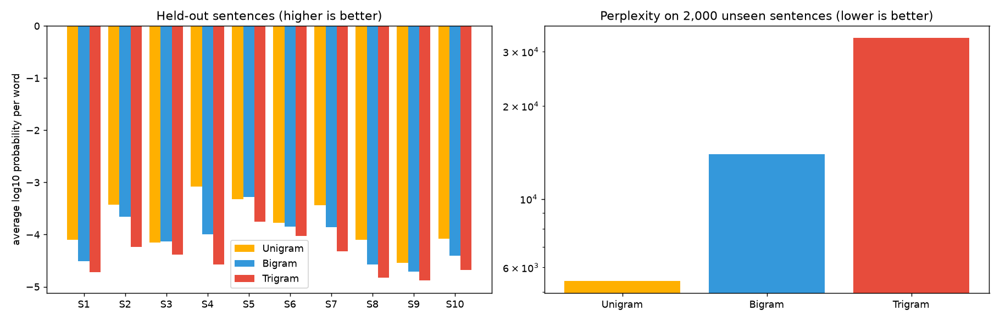

# AG News Topic Classifier


End-to-end NLP project that classifies news articles into four topics (World, Sports, Business, Sci/Tech): text
cleaning, hand-built n-gram language models, a comparison of vectorizers and classifiers, and a Flask web app for
live predictions.

| Sports | Business | Sci/Tech |
|---|---|---|
|  |  |  |

## Results

| | Accuracy |
|---|---|
| Best model on validation (TF-IDF + Linear SVC, article-level split) | 88.3% |
| **External test set (7,600 unseen articles)** | **91.0%** |





Business and Sci/Tech are the hardest pair to separate (about 87-89% F1), Sports is the easiest (96%).

### How the evaluation is done

- Training works on **sentences**, but all sentences of one article stay on the same side of the split
  (`GroupShuffleSplit`). A plain random split puts sentences of the same article in train and validation, which
  inflates the score.
- The best vectorizer + classifier pair is chosen on validation data only; the external `test.csv` is used once at the end.
- The final model is refit on all training sentences. Linear SVC has no probabilities, so it is wrapped in
  `CalibratedClassifierCV`: the confidence shown in the app is a real calibrated probability, not a softmax of raw scores.

## Project structure

```
├── config.py              # paths and constants
├── run_pipeline.py        # EDA -> n-gram models -> training in one command
├── app.py                 # Flask app
├── templates/index.html   # front-end
├── src/
│   ├── preprocessing.py   # one clean_text() used by training AND the app
│   ├── eda.py             # dataset figures
│   ├── ngram_lm.py        # manual unigram/bigram/trigram models with Laplace smoothing
│   ├── train.py           # vectorizer x classifier comparison, evaluation, saving
│   └── predictor.py       # loads the model and predicts one text
├── data/                  # train.csv.gz, test.csv
├── models/                # tfidf_vectorizer.pkl, topic_classifier.pkl, metrics.json
└── img/                   # screenshots and figures
```

## Setup and run

```bash
pip install -r requirements.txt
python app.py
```

Open `http://127.0.0.1:5000`. The trained model is included. NLTK data (punkt, wordnet, stopwords) downloads
automatically on first use. To rebuild everything from the raw data:

```bash
python run_pipeline.py
```

The first run cleans 120,000 articles (a few minutes) and caches the result in `data/`.

## Dataset

The **AG News** benchmark: 120,000 training articles (30,000 per topic) and 7,600 test articles
(1,900 per topic), each with `Class Index`, `Title` and `Description`.

| Label | Topic | Example |
|---|---|---|
| 1 | World | International politics, conflicts, UN meetings |
| 2 | Sports | Match results, players, championships |
| 3 | Business | Stocks, companies, oil prices, earnings |
| 4 | Sci/Tech | AI, space, gadgets, scientific discoveries |



Preprocessing (`src/preprocessing.py`): lowercase, remove URLs, emails, numbers and punctuation, tokenize, remove
stop words, lemmatize; descriptions are split into sentences first.

## Manual n-gram language models

`src/ngram_lm.py` builds unigram, bigram and trigram counts by hand with Laplace (add-one) smoothing and scores
sentences in log space (raw probability products underflow to zero on long sentences).

| Model | Perplexity on 2,000 unseen sentences |
|---|---|
| Unigram | 5,423 |
| Bigram | 13,963 |
| Trigram | 33,198 |

Higher-order models are *worse* here: with a vocabulary of about 73,000 words, add-one smoothing gives huge
probability mass to unseen bigrams and trigrams. Better smoothing (Kneser-Ney, backoff) would reverse the order.



## License

MIT License
